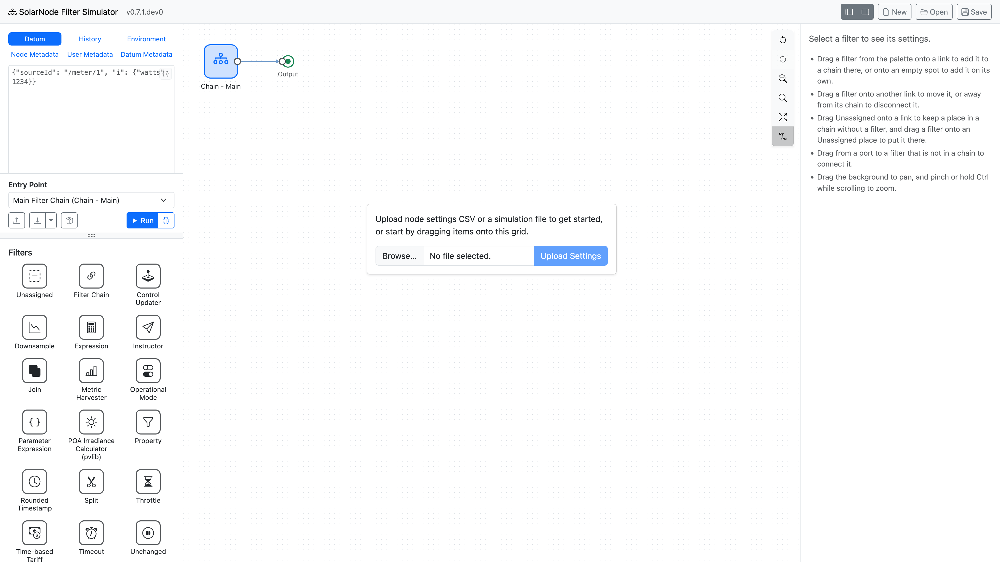
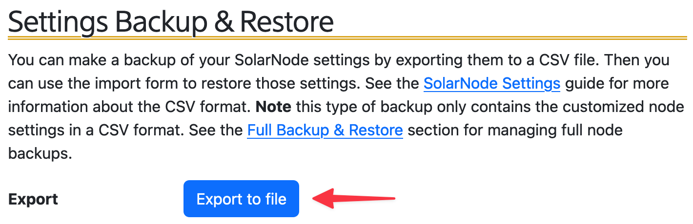

# Creating a simulation

To create a simulation you can create one from scratch just using the Simulator, and you
can also import settings from a SolarNode to start with its filter settings.

## Create from scratch

To create a simulation from scratch, drag your desired filters from the [Filter palette][filter-palette]
onto the [Canvas][canvas].

<figure markdown>
{width=1920}
<figcaption markdown>A new, empty simulation.</figcaption>
</figure>

Drop filters onto a connection line to insert the filter into that position within the overall flow.
Drop filters anywhere else on the canvas if you would like to configure its settings without it
participating in the main flow.

<video controls poster="../images/filter-palette-drag-to-canvas@2x.png">
<source src="../images/filter-palette-drag-to-canvas.mp4" type="video/mp4">
</video>

## Import filter settings from SolarNode

You can import the settings from a SolarNode that already has filters configured, so you can then
simulate that exact setup. From SolarNode, go to [Settings > Backups > Settings Backup & Restore][sn-settings-backup]
and click the **Export to file** button to download the node's settings as a CSV file.

<figure markdown>
{width=710}
<figcaption markdown></figcaption>
</figure>

The exported file will include all of SolarNode's settings. The SolarNode Filter Simulator will
ignore non-filter settings so you do not have to worry about any other settings are included in the
export, **except** for some controls and Control Conductors, which the Simulator adds to the
**Controls** tab, and the [datum sources](./datum-sources.md) it supports, which it adds to the
**Datum Sources** tab:

- Each [Modbus][modbus-control] or [BACnet][bacnet-control] Control becomes a control of its type,
  without a starting value, which publishes a datum every time it is set. A Modbus control keeps
  its datum property name.
- Each Output control of a [GPIO][gpio-control] Control becomes a Boolean control starting at
  `false`, which publishes a datum every time it is set, with its datum property name and type. Input controls are not supported.
- Each Mock Control becomes a control with its type and initial value, which publishes a datum when
  its value changes.
- Each [Operational Mode Switch][opmode-switch] becomes an Operational Mode Switch control of its
  mode, which publishes a datum when its value changes.
- Any [Control Datum Sources][control-ds] are used to decide whether each control publishes at all,
  and whether its datum are persisted. A file without Control Datum Sources publishes every
  control's datum, without persisting them, like a Control Datum Source with its default settings.
- Each [Control Conductor][control-conductor] keeps its settings.
- Each Fixed Data, Mock Battery, Mock Energy Meter, and Time-based Tariff datum source keeps its
  settings. Settings from SolarNode 1.x, like `triggerCronExpression`, are changed to their current
  names, like `schedule`, so the datum source's card shows them.
- Each [Operational Mode Invoker](./datum-sources.md#operational-mode-invokers) keeps its settings.

When you add a file to a simulation, its controls replace those with the same control ID, its
conductors those with the same Service Name, and its datum sources those of the same type and
instance ID. When you replace the simulation with a file that has controls, conductors, or datum
sources, they replace all of them. ++ctrl+z++ does not undo changes to the **Controls** and
**Datum Sources** tabs. Exports include only the filter settings.

Now in the Simulator, click on the **Import settings** button in the [Action pane][action-pane]
and select the file you exported from SolarNode.

<figure markdown>
{width=352}
</figure>

## Making changes

Click on individual filters on the canvas to inspect its settings in the [Inspector][inspector].
You can modify the filter's settings there.

You can remove a filter from the canvas by selecting it, then typing the ++bksp++ or ++del++
key.

You can use ++ctrl+z++ or ++cmd+z++ to undo your changes as you go.

[action-pane]: ./getting-your-bearings.md#action-pane
[bacnet-control]: https://solarnetwork.github.io/solarnode-handbook/users/controls/bacnet/
[canvas]: ./getting-your-bearings.md#canvas
[control-conductor]: https://solarnetwork.github.io/solarnode-handbook/users/controls/conductor/
[control-ds]: https://solarnetwork.github.io/solarnode-handbook/users/datum-sources/control/
[control-pane]: ./getting-your-bearings.md#control-pane
[opmode-switch]: https://github.com/SolarNetwork/solarnetwork-node/tree/develop/net.solarnetwork.node.control.opmode#operational-mode-switch
[downsample]: https://solarnetwork.github.io/solarnode-handbook/users/datum-filters/downsample/
[filter-palette]: ./getting-your-bearings.md#filter-palette
[gpio-control]: https://solarnetwork.github.io/solarnode-handbook/users/controls/gpio/
[inspector]: ./getting-your-bearings.md#inspector
[modbus-control]: https://solarnetwork.github.io/solarnode-handbook/users/controls/modbus/
[sn-settings-backup]: https://solarnetwork.github.io/solarnode-handbook/users/setup-app/settings/backups/#settings-backup-restore
