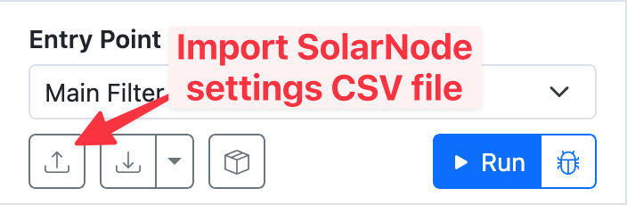

# Creating a simulation

To create a simulation you can create one from scratch just using the Simulator, and you
can also import settings from a SolarNode to start with its filter settings.

## Create from scratch

To create a simulation from scratch, drag your desired filters from the [Filter palette][filter-palette]
onto the [Canvas][canvas].

<figure markdown>
{width=1920}
<figcaption markdown>A new, empty simulation.</figcaption>
</figure>

Drop filters onto a connection line to insert the filter into that position within the overall flow.
Drop filters anywhere else on the canvas if you would like to configure its settings without it
participating in the main flow.

<video controls poster="../images/filter-palette-drag-to-canvas@2x.png">
<source src="../images/filter-palette-drag-to-canvas.mp4" type="video/mp4">
</video>

## Import filter settings from SolarNode

You can import the settings from a SolarNode that already has filters configured, so you can then
simulate that exact setup. From SolarNode, go to [Settings > Backups > Settings Backup & Restore][sn-settings-backup]
and click the **Export to file** button to download the node's settings as a CSV file.

<figure markdown>
{width=710}
<figcaption markdown></figcaption>
</figure>

The exported file will include all of SolarNode's settings. The SolarNode Filter Simulator will
ignore non-filter settings so you do not have to worry about any other settings are included in the
export.

Now in the Simulator, click on the **Import settings** button in the [Control pane][control-pane]
and select the file you exported from SolarNode.

<figure markdown>
{width=352}
</figure>

## Making changes

Click on individual filters on the canvas to inspect its settings in the [Inspector][inspector].
You can modify the filter's settings there.

You can remove a filter from the canvas by selecting it, then typing the ++bksp++ or ++del++
key.

You can use ++ctrl+z++ or ++cmd+z++ to undo your changes as you go.

[canvas]: ./getting-your-bearings.md#canvas
[control-pane]: ./getting-your-bearings.md#control-pane
[downsample]: https://solarnetwork.github.io/solarnode-handbook/users/datum-filters/downsample/
[filter-palette]: ./getting-your-bearings.md#filter-palette
[inspector]: ./getting-your-bearings.md#inspector
[sn-settings-backup]: https://solarnetwork.github.io/solarnode-handbook/users/setup-app/settings/backups/#settings-backup-restore
