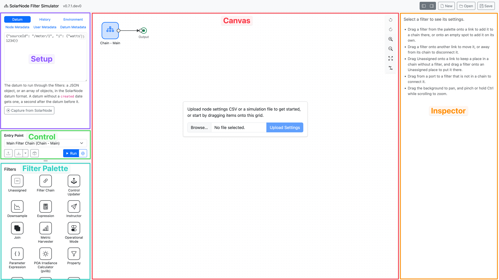
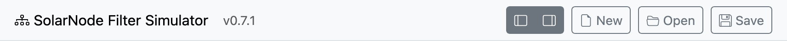
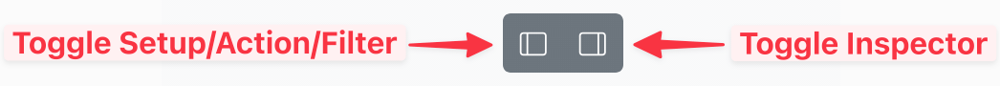
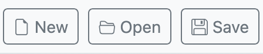
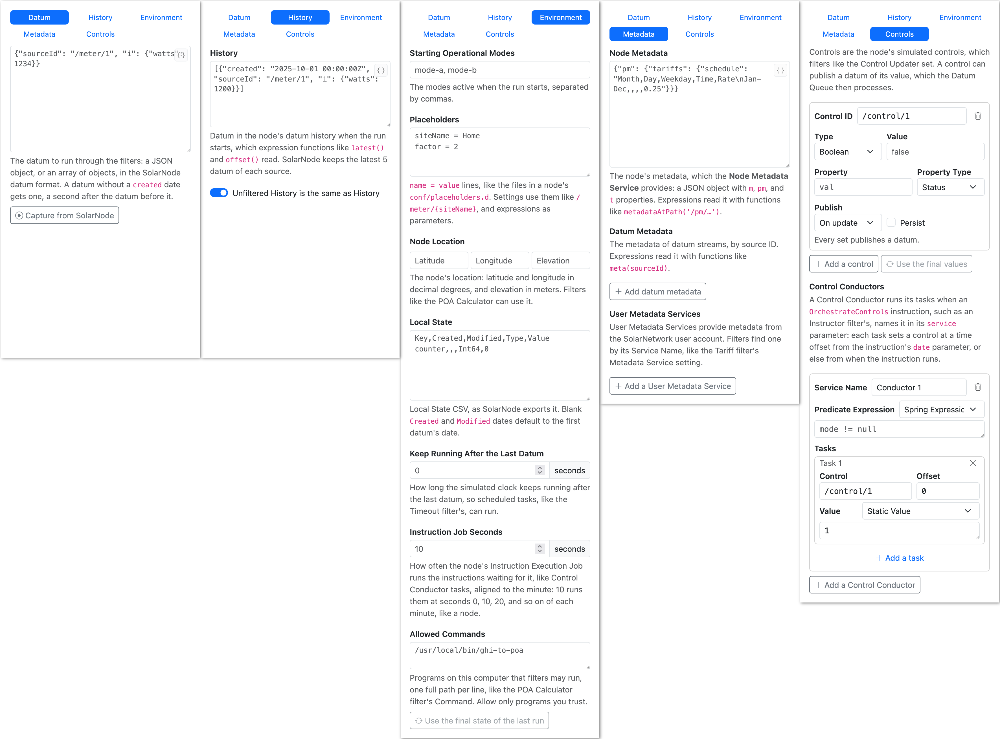
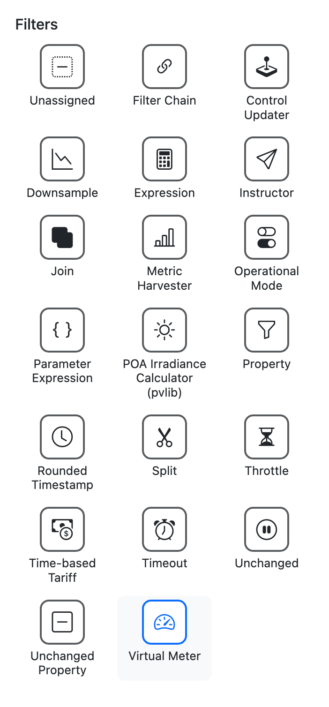
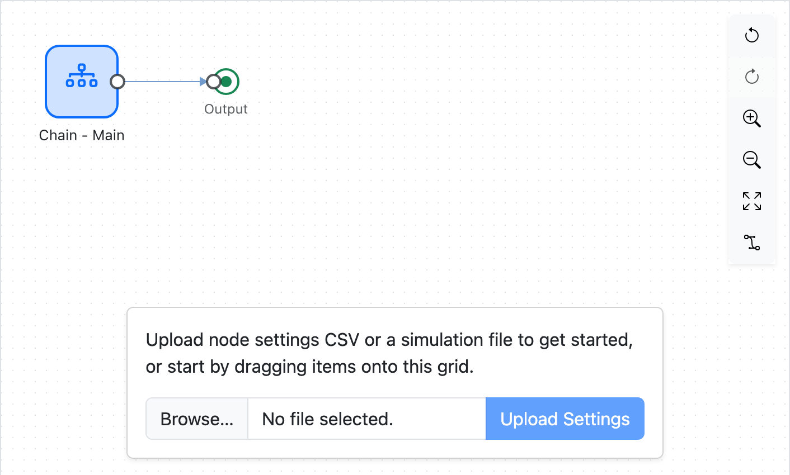
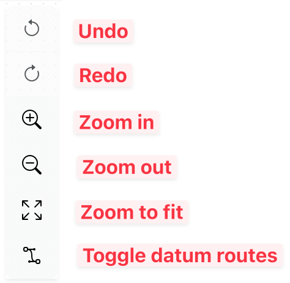
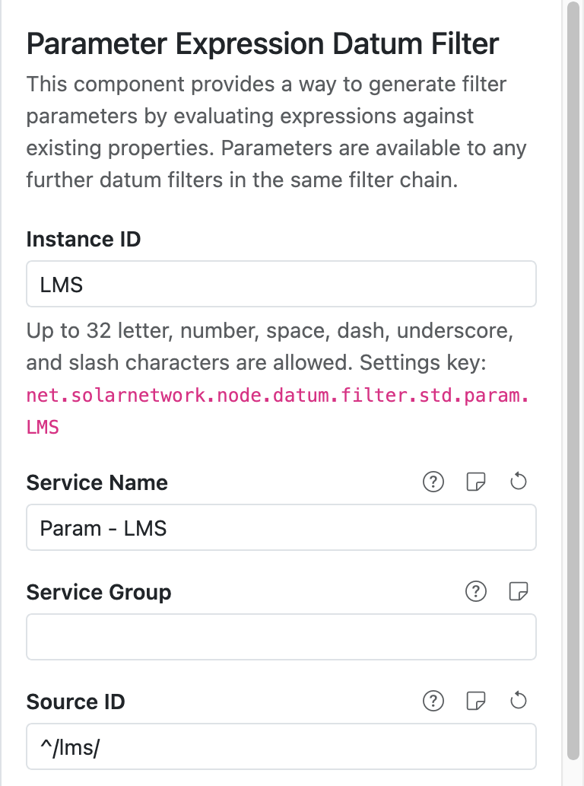

# Getting your bearings

When you first visit the application, you are presented with four main panes:

{width=1440}

* [Toolbar](#toolbar) (top bar) - the application version and some action buttons.
* [Setup](#setup-pane) (top left) - where you configure the overall parameters of the simulation,
  such as the datum to run through the filters, node metadata, and placeholders.
* [Action](#action-pane) (middle left) - where you can start the simulation as well as import or
  export the filter settings as CSV files.
* [Filter Palette](#filter-palette) (bottom left) - a list of the available filters that you can
  drag onto the canvas.
* [Canvas](#canvas) (middle) - a flow chart style visualization of the simulation.
* [Inspector](#inspector) - shows the editable properties of a filter after you click on one in the
  canvas.

## Toolbar

<figure markdown>
{width=856}
</figure>

The top of the window contains the application name and version, along with some
action buttons on the right side.

### Pane toggle buttons

<figure markdown>
{width=523}
</figure>

The first two buttons in the toolbar allow you to toggle the left and right applicaiton pane
visibility, to give the [Canvas](#canvas) more room.

### Simulation buttons

<figure markdown>
{width=224}
<figcaption markdown>Buttons to reset, open, or export the simulation.</figcaption>
</figure>

The **New**, **Open**, and **Save** buttons on the right side of the toolbar are for managing
the entire simulation:

| Button | Description |
|:-------|:------------|
| **New** | Reset the simulation back to an empty state. |
| **Open** | Upload a saved simulation file, replacing the current simulation. |
| **Save** | Download the simulation as a file. |

!!! tip

	A saved simulation file contains everything you configure in the simulation, including the
	inputs in the [Setup](#setup-pane). You can share this file with others so they can run your
	simulation exactly as you have.

## Setup pane

<figure markdown>
{width=1772}
<figcaption markdown>The various tab views within the Setup pane.</figcaption>
</figure>

The Setup pane is where you configure the overall SolarNode simulation universe. At a minimum you
must provide the initial [datum][datum] to send into the filter execution flow. These initial datum
represent data captured from SolarNode [Datum Sources][datum-sources] that read from devices like
meters and power inverters.

The **History**, **Environment**, **Metadata**, and **Controls** tabs in this pane allow you to
configure other simulated SolarNode services like [Metadata][metadata],
[Placeholders][placeholders], [Operational Modes][op-modes], [Local State][local-state], and more.
Generally you need to configure everything your filters expect to be available when they run in
SolarNode.

The **Metadata** tab holds the node's metadata, the metadata of each datum stream (one per source
ID), and any User Metadata Services.

The **Controls** tab holds the node's simulated controls, which filters like the Control Updater
set. See [Controls and Instructions](./controls-and-instructions.md) for more details.

## Action pane

<figure markdown>
{width=351}
</figure>

The Action pane is where you can:

* import filter settings from a SolarNode
* export the simulation's filter settings, so you can apply them to a SolarNode
* add _external_ filter settings, like those contributed by `solarnode-config-*` packages in
  SolarNodeOS; these are not exported with your simulation settings
* run (or debug) the simulation

The **Entry Point** is the name of the filter to pass the input datum to when you run the simulation.
Typically this is the [Main Filter Chain][main-filter-chain], but you can actually specify any filter
in the simulation.

## Filter palette

<figure class="limit-height" markdown>
{width=351}
</figure>

The Filter palette shows you all the available filters you can use in the simulator. Simply drag a
filter from the palette over to the [canvas](#canvas) to add it to the simulation. Drop the filter
on any connector line between filters to insert that filter into the execution flow at that point.

<video controls poster="../images/filter-palette-drag-to-canvas@2x.png">
<source src="../images/filter-palette-drag-to-canvas.mp4" type="video/mp4">
</video>

## Canvas

<figure markdown>
{width=706}
<figcaption>The Canvas when the application first starts.</figcaption>
</figure>

The Canvas is where the filter flow diagram is drawn. You can drag filters from the Filter palette
and drop them onto the Canvas to add them to your simulation. The Canvas has a toolbar in the
upper-right of the pane:

<figure markdown>
{width=237}
<figcaption>The Canvas toolbar.</figcaption>
</figure>

The **Toggle datum routes** button is used to show or hide lines representing "routes" each
datum takes as it flows through the filters during a simulation run.

## Inspector

<figure markdown>
{width=384}
<figcaption>The Inspector showing an example filter's settings.</figcaption>
</figure>

If you click on a filter in the Canvas, the Inspector will show you an editable form for that
filter's settings. The form looks and works much the same way as it does in SolarNode, except that
changes are saved automatically.

[datum]: https://solarnetwork.github.io/solarnode-handbook/users/datum/
[datum-sources]: https://solarnetwork.github.io/solarnode-handbook/users/datum-sources/
[control-conductor]: https://solarnetwork.github.io/solarnode-handbook/users/controls/conductor/
[instructor]: https://solarnetwork.github.io/solarnode-handbook/users/datum-filters/instructor/
[local-state]: https://solarnetwork.github.io/solarnode-handbook/users/local-state/
[main-filter-chain]: https://solarnetwork.github.io/solarnode-handbook/recipes/datum-filters/main-filter-chain/
[metadata]: https://github.com/SolarNetwork/solarnetwork/wiki/SolarNet-API-global-objects#metadata
[op-modes]: https://solarnetwork.github.io/solarnode-handbook/users/op-modes/
[placeholders]: https://solarnetwork.github.io/solarnode-handbook/users/placeholders/
