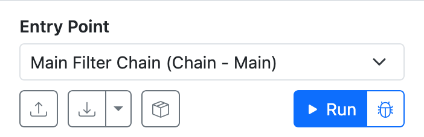

# Getting your bearings

When you first visit the application, you are presented with four main panes:

{width=1920}

* [Setup](#setup-pane) (top left) - where you configure the overall parameters of the simulation, such as the datum to run through the filters, node metadata,
and placeholders.
* [Control](#control-pane) (middle left) - where you can start the simulation as well as import or export the filter settings as CSV files.
* [Filter Palette](#filter-palette) (bottom left) - a list of the available filters that you can drag onto the canvas.
* [Canvas](#canvas) (middle) - a flow chart style visualization of the simulation.
* [Inspector](#inspector) - shows the editable properties of a filter after you click on one in the canvas.

## Setup pane

<figure markdown>
{width=2106}
<figcaption markdown>The various tab views within the Setup pane.</figcaption>
</figure>

The Setup pane is where you configure the overall SolarNode simulation universe. At a minimum you
must provide the initial [datum][datum] to send into the filter execution flow. These initial datum
represent data captured from SolarNode [Datum Sources][datum-sources] that read from devices like
meters and power inverters.

The **History**, **Environment**, **Node Metadata**, **User Metadata**, and **Datum Metadata** tabs
in this pane allow you to configure other simulated SolarNode services like [Metadata][metadata],
[Placeholders][placeholders], [Operational Modes][op-modes], [Local State][local-state], and more.
Generally you need to configure everything your filters expect to be available when they run in
SolarNode.

## Control pane

<figure markdown>
{width=351}
</figure>

The Control pane is where you can:

* import filter settings from a SolarNode
* export the simulation's filter settings, so you can apply them to a SolarNOde
* add _external_ filter settings, like those contributed by `solarnode-config-*` packages in
  SolarNodeOS; these are not exported with your simulation settings
* run (or debug) the simulation

The **Entry Point** is the name of the filter to pass the input datum to when you run the simulation.
Typically this is the [Main Filter Chain][main-filter-chain], but you can actually specify any filter
in the simulation.

## Filter palette

<figure class="limit-height" markdown>
{width=351}
</figure>

The Filter palette shows you all the available filters you can use in the simulator. Simply drag a
filter from the palette over to the [canvas](#canvas) to add it to the simulation. Drop the filter
on any connector line between filters to insert that filter into the execution flow at that point.

<video controls poster="../images/filter-palette-drag-to-canvas@2x.png">
<source src="../images/filter-palette-drag-to-canvas.mp4" type="video/mp4">
</video>

## Canvas

TODO

## Inspector

TODO

[datum]: https://solarnetwork.github.io/solarnode-handbook/users/datum/
[datum-sources]: https://solarnetwork.github.io/solarnode-handbook/users/datum-sources/
[local-state]: https://solarnetwork.github.io/solarnode-handbook/users/local-state/
[main-filter-chain]: https://solarnetwork.github.io/solarnode-handbook/recipes/datum-filters/main-filter-chain/
[metadata]: https://github.com/SolarNetwork/solarnetwork/wiki/SolarNet-API-global-objects#metadata
[op-modes]: https://solarnetwork.github.io/solarnode-handbook/users/op-modes/
[placeholders]: https://solarnetwork.github.io/solarnode-handbook/users/placeholders/
