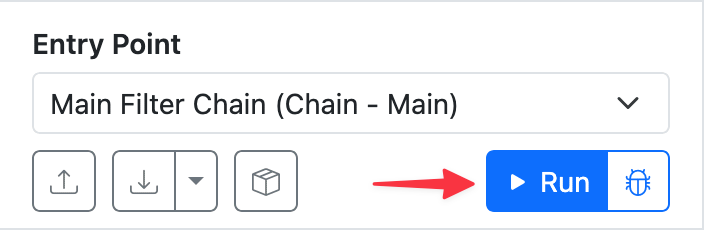
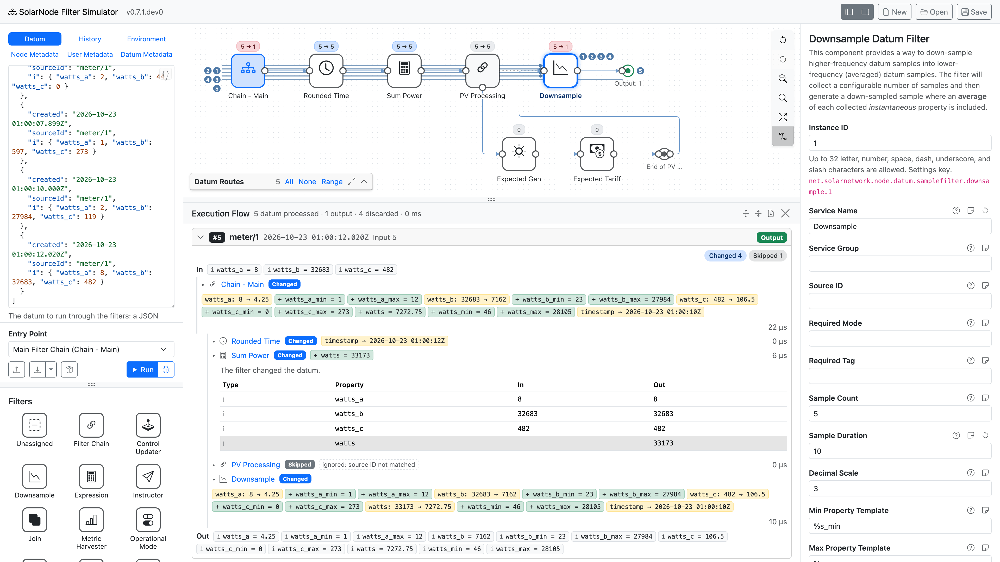
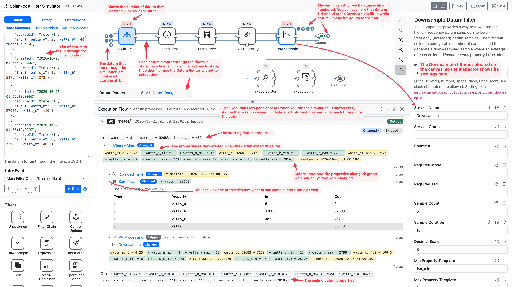
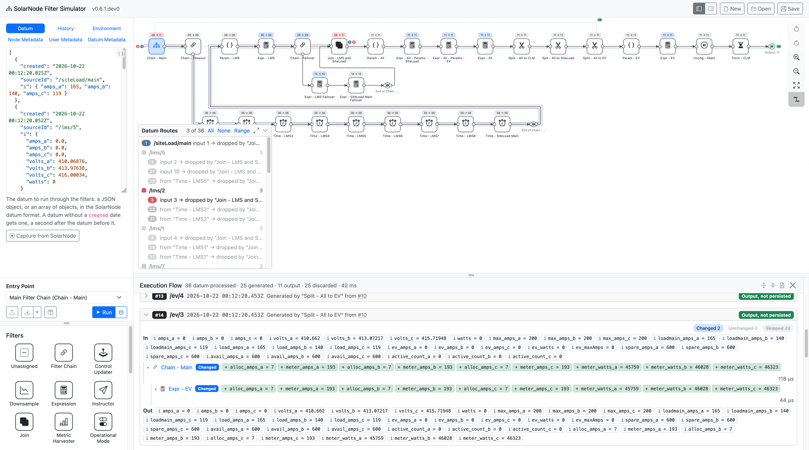

# Running a simulation

Once you have a simualtion set up, run it by clicking the **Run** button in the [Control pane][control-pane]:

<figure markdown>
{width=352}
<figcaption markdown>Execute a simulation by clicking the **Run** button.</figcaption>
</figure>

## Simulation result

After running a simulation, an **Execution Flow** pane will appear below the Canvas, with the results
of the simulation. The [Canvas][canvas] will show datum input/output counts above each filter.

<figure markdown>
{width=1920}
<figcaption markdown>An example simulation. In this run 5 datum were passed through the filters,
and a [Downsample][downsample] filter discarded the first 4, emitting a modified "downsampled"
5^th^ datum.</figcaption>
</figure>

Here is an annotated version of that screen shot that showcases some high-level aspects
of what you are seeing:

<figure markdown>
{width=1920}
</figure>

## Generated datum

Some filters like [Split][split] generate _new_ datum. These datum are added to SolarNode's
[Datum Queue][datum-queue] and then processed like any other datum, running through the
configured filters themselves.

<figure markdown>
{width=1920}
<figcaption markdown>An example simulation with generated datum.</figcaption>
</figure>

In this example the **Split - All to EV** Split filter generated a new `/ev/3` datum (#14 in the
simulation). The Canvas shows a dotted line that goes from that filter back to the starting point.
You can then see datum #14's route through the entire flow, ending at the **Output** at the far
right.

[canvas]: ./getting-your-bearings.md#canvas
[control-pane]: ./getting-your-bearings.md#control-pane
[datum-queue]: https://solarnetwork.github.io/solarnode-handbook/users/datum-filters/#datum-queue
[downsample]: https://solarnetwork.github.io/solarnode-handbook/users/datum-filters/downsample/
[split]: https://solarnetwork.github.io/solarnode-handbook/users/datum-filters/split/
